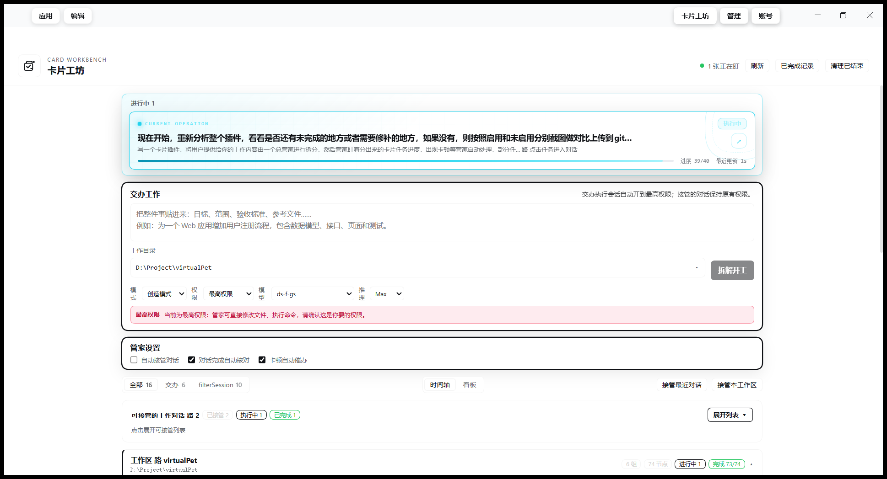

# 卡片工坊 (`dsh-card-workbench`)

把工作交给卡片工坊：它负责拆卡、派单、盯办、处理卡顿、逐张核对，并把 Harness 中已有的工作对话接管成卡片组统一盯进度。

- 无第三方运行时依赖，无构建步骤；
- 只使用 Harness Host 服务、Node 内置模块和默认模型；
- 同一份目录可安装到任意 profile、任意工作区；
- 支持 Windows / macOS / Linux。

## 界面

| 未启用插件 | 启用插件 |
| --- | --- |
|  |  |
| 原生 DSH：左侧栏、对话页、输入区正常显示 | 卡片工坊接管全宽工作区：任务卡、交办区、管家设置、可接管对话 |

插件启用期间，左侧原生栏会被隐藏，页面切换为全宽卡片工坊；禁用插件后，左侧栏和原生布局立即恢复。

## 快速开始

### 安装

1. 把整个 `dsh-butler` 目录复制到目标机器，不需要 `node_modules`，不需要构建。
2. 打开 Harness 的「设置 → 插件」，选择安装本地目录。
3. 确认 `dsh-card-workbench` 为启用状态，安装结果应为 `application: applied`。
4. 刷新一次 Web 页面。
5. 用 `Ctrl/Cmd+Shift+B`，或点击输入框右侧的「卡片工坊」，打开面板。

### 使用

1. 在「交办工作」中粘贴完整需求，选择工作目录。
2. 点击「拆解开工」，或直接按 `Enter`（`Shift+Enter` 换行）。
3. 卡片工坊会拆出 2–6 张卡，逐张派发、跟踪、催办和核对。
4. 展开任务卡可查看交付、缺口和对话；「打开对话」会进入对应执行会话。

## 两种工作模式

### 1. 交办工作（默认）

- 用默认模型拆卡，生成可验收的执行任务；
- 每张卡开独立执行会话，把任务和验收标准交给执行者；
- 监听执行会话，长时间无进展时自动催办、中断、续跑；
- 卡片结束后进入核对队列；不通过则退回返工；
- 全部完成后做整体终审，发现缺口自动补卡。

### 2. 接管工作对话（默认关闭）

开启「自动接管对话」后，管家会扫描已有和新建工作对话，把每个 turn 变成卡片：

- 同一轮的多个用户消息会合并，不会拆碎；
- 记录用户请求、工具调用、执行结果和核对结论；
- 一轮结束后自动核对，缺口作为核对消息发回原对话；
- 可按全部 / 交办 / 对话组筛选，逐个暂停、继续、催办、核对或移出管家；
- 接管对话默认不提升权限。

相关开关在「管家设置」中：

| 开关 | 默认 | 说明 |
| --- | --- | --- |
| 自动接管对话 | 关 | 开启后才扫描并接管已有/新工作对话 |
| 新对话自动跳转 | 开 | 新对话被接管并收到第一条工作请求时跳到卡片页 |
| 对话完成自动核对 | 开 | 每轮结束自动核对，有问题回原对话补齐 |
| 卡顿自动催办 | 开 | 长时间无进展时自动催办/续跑 |

开关保存在看板数据中，重启后保留。

## 主要能力

### 卡片与看板

- 时间轴按时间倒序展示任务节点，默认只显示时间、摘要、状态；
- 点击「任务时间轴」名称展开/收起节点详情；
- 可按工作区折叠，超过 1 天无真实活动的区块移入「历史工作区」；
- 支持依赖 DAG、优先级、并行执行和独立的核对队列；
- 看板只展示状态，不允许拖拽绕过验收。

### 交办与执行

- 工作目录必选，目录树懒加载，点击文件夹即选中；
- 目录不在现有工作区时自动注册新工作区；
- 全局并发预算由所有项目共享，按最久未派单优先轮转；
- 执行心跳在 Host 进程 `lib/executor.js` 中运行，不依赖页面是否打开；
- 页面只是观察者，打开或关闭对话都不会启动、暂停或重启任务。

### 卡片内对话

- 任务卡可直接对话，不需要打开会话窗口；
- 对话组也有独立输入框，问题会作为新任务卡进入时间轴；
- 支持模型、推理等级、模式和权限预设选择；
- 草稿按 job/card 持久化，切换页面或重载后可恢复；
- 对话历史按会话 ID 合并，滚动位置保存在 `localStorage`。

### 状态与轮询

- 客户端状态 store 在插件 `apply` 时启动，对话页、工坊页、市场页共享同一份状态；
- 全局热路径轮询 `/api/pulse`，完整快照仅在工坊页面可见时加载；
- 可接管会话清单按 `sessionsTtlMs` 缓存；
- 状态轮询不会因为打开工坊页面而长时间占用 Host 事件循环。

## 权限与安全

默认 `fullAccess: false`：

- 保留会话原有权限，不自动提升；
- 只有显式设置 `fullAccess: true` 才切到最高权限；
- 即使权限策略为 `ask`，审批也可直接在卡片里选择「允许一次 / 拒绝」；
- 被接管的既有对话同样只在 `fullAccess: true` 时提升权限；
- `fullAccess: true` 意味着执行者可以修改工作目录之外的任何文件，请明确开启。

## 数据与恢复

```text
看板数据：$DSH_HOME/.dsh-butler/board.json
未设置 DSH_HOME：~/.dsh/.dsh-butler/board.json
Windows：%USERPROFILE%\.dsh\.dsh-butler\board.json
```

- 执行者的真实工作记录保存在各自的 Harness 会话中，看板只保存编排状态；
- Host 重启后运行中的工作会暂停，点「继续」即可从原会话续跑；
- 所有已接管对话会在启动后重新扫描并恢复。

## 配置

### 在设置中修改

打开 Harness 的「设置 → 插件 → 卡片工坊」，点击配置页即可修改参数。设置页中的参数名称、说明均为中文，保存后立即作用于执行心跳、拆卡、核对、卡顿判断和模型调用。

设置保存在：

```text
$DSH_HOME/.dsh-butler/settings.json
```

profile 插件行的 `config` 仍作为初始值；设置页保存的值会覆盖对应字段。数值参数会校验类型和范围，非法值会直接提示并拒绝保存；`dataDir`、面板入口等启动参数不在设置页中修改。

### profile config

也可以在 profile 的插件行 `config` 中设置：

| 参数 | 默认 | 说明 |
| --- | --- | --- |
| `maxCards` | 6 | 拆卡上限 |
| `maxConcurrency` | 4 | 全局执行槽位；硬上限 8 |
| `maxVerifications` | 2 | 并行核对数；独立队列，硬上限 4 |
| `stallMs` | 600000 | 多久无进展判定卡顿（10 分钟） |
| `toolStallMs` | 1800000 | 工具仍在执行时的卡顿阈值（30 分钟） |
| `maxStalls` | 3 | 同一张卡最多自动续跑次数 |
| `maxAttempts` | 5 | 派单/续跑总次数上限 |
| `maxFixRounds` | 2 | 核对不通过后退回轮数 |
| `maxGapRounds` | 2 | 终审后自动补卡轮数 |
| `schedulerIntervalMs` | 1000 | Host 执行心跳间隔（200–10000ms） |
| `sessionsTtlMs` | 30000 | 可接管会话清单缓存时长 |
| `fullAccess` | false | 是否给执行会话最高权限 |
| `provider` / `model` | 默认模型 | 拆卡/核对模型 |
| `dataDir` | `$DSH_HOME/.dsh-butler` | 看板数据目录 |

## 布局说明

插件激活期间使用持久 CSS：

```css
[class*="_sidebarCol"]{
  visibility:hidden !important;
  pointer-events:none !important;
}

div[class*="_frame"]{
  grid-template-columns:0 minmax(0,1fr) 0 !important;
}
```

- 规则在插件启用期间持续存在，页面路由切换不会重新显示侧边栏；
- 不通过 JS 逐节点写 `style`，也不做 500ms 全量扫描；
- 只有卸载插件时才移除样式，原生侧边栏和列宽恢复；
- 工坊页额外使用 `body[data-butler-page]` 控制 shell overlay，离开工坊页时自动恢复。

## 性能边界

- 插件本身不做会话历史预热；打开对话的耗时主要由 DSH 宿主对话页的历史加载和消息渲染决定；
- 归档页首批渲染 48 条记录，可继续加载，避免一次挂载全部已完成记录；
- 插件不提供对话消息的虚拟化或分页能力，因此无法承诺固定的“打开对话”耗时上限。

## 自检

```bash
node scripts/audit.mjs
node scripts/test-ui.mjs
node scripts/test-settings.mjs
node scripts/test-navigation.mjs
node scripts/test-archive-pagination.mjs
```

完整测试：

```bash
# 在插件目录下
Get-ChildItem scripts/test-*.mjs | ForEach-Object { node $_.FullName }
```

`audit.mjs` 会输出看板统计、接管代码位置、硬编码扫描结果、运行时依赖数，并在扫描到硬编码值时以退出码 1 结束，可直接用于 CI。

更多验证记录见 [`docs/`](docs/)。

## 目录

```text
index.js          Host 入口：HTTP 桥、事件监听、全局执行心跳
lib/executor.js   与页面无关的执行心跳
lib/engine.js     拆卡、派单、事件跟踪、催办、核对、终审、补卡
lib/model.js      通过共享 llm 服务调用默认模型
lib/server.js     面板与 Host 之间的同源 JSON 接口
client.js         Web 端卡片工坊页面与顶部/侧栏入口
docs/             验证记录与截图
scripts/          审计与回归测试
```

## License

MIT
